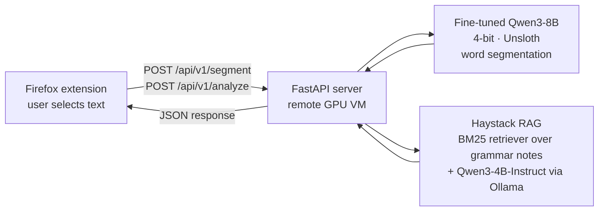

# HanziFlow · Chinese Word Segmentation Browser Extension

**Select Chinese text on any web page and instantly see it split into words, with English meanings and the grammar pattern behind the sentence.**

HanziFlow helps beginner Chinese learners read real websites. Chinese is written without spaces, so learners often can't tell where one word ends and the next begins. HanziFlow segments the text with a **fine-tuned small language model (Qwen3-8B, QLoRA)** and explains the sentence structure with a **retrieval-augmented (RAG) grammar pipeline**. It runs on our own server, with no paid NLP API.

> Course project · CSC340 Artificial Intelligence, King Mongkut's University of Technology Thonburi (KMUTT) · Team of 5

**Demo video and case study:** https://shn047.github.io/projects/hanziflow.html
**Fine-tuned model:** [ChrisMoe/Qwen3_segmented](https://huggingface.co/ChrisMoe/Qwen3_segmented)

---

## Features

| | |
|---|---|
| **One-click segmentation** | Breaks a selected sentence into words and phrases |
| **Word-by-word translation** | English meaning for every segmented word |
| **Usage patterns** | Explains the sentence's grammar structure (e.g. *Subject + 来自 + Source*) with pinyin and examples, retrieved from 434 grammar points |

## How it works



1. The user highlights Chinese text and opens the extension.
2. The extension sends the sentence to the FastAPI server.
3. **`/api/v1/segment`**: the fine-tuned Qwen3-8B model returns the segmented sentence.
4. **`/api/v1/analyze`**: Haystack retrieves the most relevant grammar notes (BM25) and an LLM writes a structured explanation: overall pattern, component breakdown, pattern formula and segment-by-segment translation.
5. The extension renders everything in an overlay on the page.

## Model and data

### Data
| Purpose | Source | Size |
|---|---|---|
| Segmentation fine-tuning | [Chinese Treebank 8.0 (LDC2013T21)](https://catalog.ldc.upenn.edu/LDC2013T21) | 3,007 files · 71,369 sentences → **17,637 after cleaning** |
| Grammar patterns (RAG) | [Chinese Grammar Wiki (AllSet Learning)](https://resources.allsetlearning.com/chinese/grammar/) | **434 patterns**, levels A1–B2 |

Grammar data pipeline: define scope (A1–B2) → collect grammar-point links → scrape page content → clean and normalise (strip HTML, fix spacing, standardise structure) → save one structured text file per grammar point.

### Model selection
We fine-tuned **four candidate models** on a subset of the segmentation data and compared their output with **human expert review, Jieba and ChatGPT**:

- **Qwen3-8B (selected)**
- DeepSeek-R1-0528-Qwen3-8B
- Llama-3.1-8B-Instruct
- IBM Granite 4.0

### Fine-tuning
- Base model: `unsloth/Qwen3-8B-bnb-4bit`
- Method: full-dataset instruction tuning with **QLoRA** adapters in **Unsloth**, using the model's chat template (system / user / assistant)
- Training: 2 epochs
- Output: exported to Hugging Face as [`ChrisMoe/Qwen3_segmented`](https://huggingface.co/ChrisMoe/Qwen3_segmented)

### Evaluation
Segmentation output was compared side by side with **Jieba** (the standard open-source segmenter) and **ChatGPT** on a set of test sentences, reviewed by human experts. The fine-tuned model was competitive with both, without depending on a paid API. *(This was a qualitative, human-reviewed comparison; we did not compute a formal F1 score.)*

## Repository structure

```
hanziflow/
├── firefox_extension/          # Browser extension (Manifest V2)
│   ├── manifest.json
│   ├── background.js           # Calls the API
│   ├── content.js              # Reads the selected text
│   └── popup/                  # Overlay UI (HTML/CSS/JS)
├── chinese-text-inference-api/ # FastAPI inference server: fine-tuned model + Haystack RAG
│   ├── main.py
│   └── requirements.txt
└── backend/                    # Lightweight FastAPI API with API-key auth and CORS
    ├── main.py                 #   (returns mock data; used for extension development)
    └── requirements.txt
```

## Running it locally

### Requirements
- NVIDIA GPU with CUDA and **about 16 GB VRAM** (for the 4-bit 8B model plus the RAG model)
- Python 3.10+
- [Ollama](https://ollama.com/) (for the grammar-explanation model)
- Firefox

### 1. Inference server
```bash
cd chinese-text-inference-api
pip install -r requirements.txt

# grammar-explanation model used by the RAG pipeline
ollama pull hopephoto/Qwen3-4B-Instruct-2507_q8:latest

# put the grammar notes (one .txt per grammar point) in ./allset_grammar_txt/
fastapi run          # serves on http://0.0.0.0:8000
```
The segmentation model (`ChrisMoe/Qwen3_segmented`) downloads from Hugging Face on first run.

> **Note:** the grammar text files are not included in this repository. They were scraped from the Chinese Grammar Wiki for educational use. Generate your own with the data pipeline above.

### 2. Firefox extension
1. In `firefox_extension/background.js`, set `FASTAPI_URL` and `ANALYZE_URL` to your server's address, and set `INTERNAL_API_KEY` to your own key.
2. Add your server address to `permissions` in `manifest.json`.
3. Open `about:debugging#/runtime/this-firefox` → **Load Temporary Add-on…** → select `firefox_extension/manifest.json`.
4. Select Chinese text on any page and click the HanziFlow icon.

### API
| Endpoint | Body | Returns |
|---|---|---|
| `POST /api/v1/segment` | `{"content": "<sentence>"}` | `{"segments": "<word> <word> ..."}` |
| `POST /api/v1/analyze` | `{"content": "<sentence>"}` | `{"report": "<structured grammar explanation>"}` |

## Tech stack
**Model:** Qwen3-8B · QLoRA · Unsloth · Hugging Face Transformers · bitsandbytes (4-bit)
**RAG:** Haystack 2 · BM25 retrieval · Ollama (Qwen3-4B-Instruct)
**Backend:** Python · FastAPI · Pydantic
**Frontend:** Firefox WebExtension (JavaScript, HTML, CSS)

## Course
CSC340 Artificial Intelligence, KMUTT

**My role:** fine-tuning and benchmarking the segmentation model, and co-designing the architecture that serves it to the browser extension.

Inference API also maintained at [yethu/chinese-text-inference-api](https://github.com/yethu/chinese-text-inference-api).

## What we learned
- Parameter-efficient fine-tuning (QLoRA) makes deploying a language model practical on a single GPU.
- Comparing several base models on the same task, judged by people, is more convincing than picking one by reputation.
- System integration (API design, CORS and browser-extension security) matters as much as model quality.
